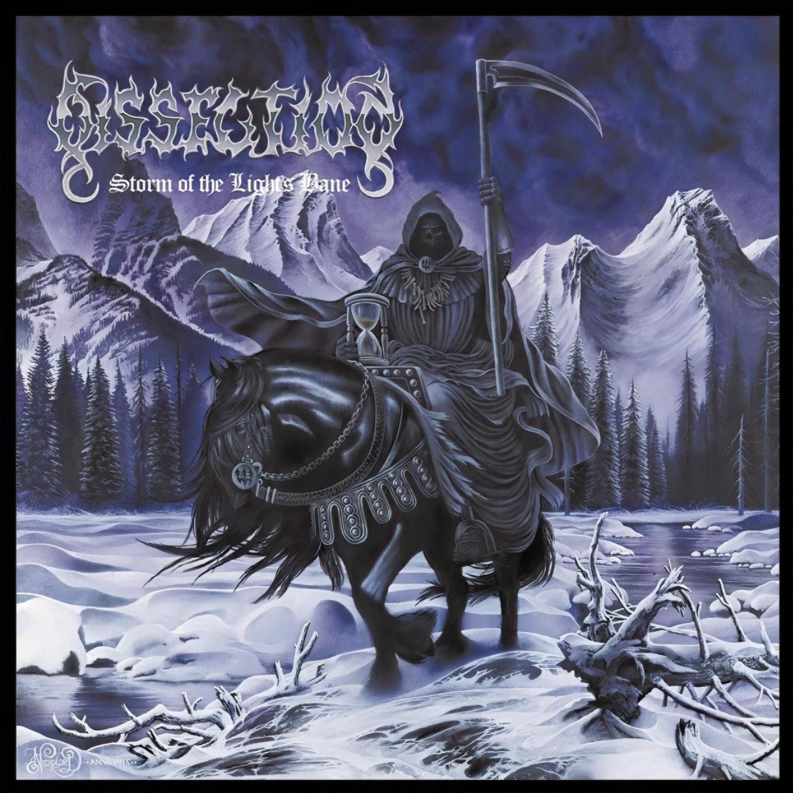
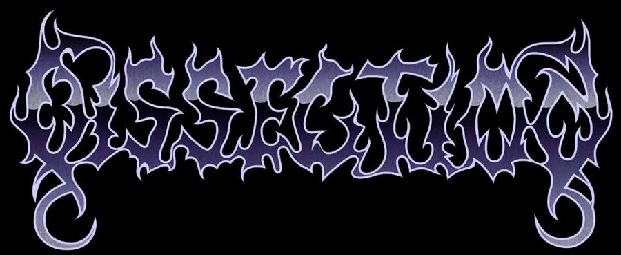

 
# 𝕷𝕬𝖀𝕽𝕰𝕹Ț𝕴𝖀 𝕸𝕬𝕮𝕬𝕽𝕴

**𝕮𝕺𝕸𝕻𝖀𝕿𝕰𝕽 𝕾𝕮𝕴𝕰𝕹𝕮𝕰 · 𝕾𝕺𝕱𝕿𝖂𝕬𝕽𝕰 𝕯𝕰𝖁𝕰𝕷𝕺𝕻𝕸𝕰𝕹𝕿 · 𝕬𝖀𝕿𝕺𝕸𝕬𝕿𝕴𝕺𝕹**

---

 

### 𝔖𝔱𝔲𝔡𝔢𝔫𝔱 𝔦𝔫𝔱𝔢𝔯𝔢𝔰𝔞𝔱 𝔡𝔢 𝔰𝔬𝔣𝔱𝔴𝔞𝔯𝔢 𝔡𝔢𝔳𝔢𝔩𝔬𝔭𝔪𝔢𝔫𝔱 \| ℭ𝔬𝔪𝔭𝔲𝔱𝔢𝔯 𝔖𝔠𝔦𝔢𝔫𝔠𝔢 \| 𝔊𝔞𝔪𝔢 𝔇𝔢𝔳𝔢𝔩𝔬𝔭𝔪𝔢𝔫𝔱 \| 𝔄𝔲𝔱𝔬𝔪𝔞𝔱𝔦𝔬𝔫

𝔅𝔲𝔫 𝔳𝔢𝔫𝔦𝔱 𝔭𝔢 𝔭𝔯𝔬𝔣𝔦𝔩𝔲𝔩 𝔪𝔢𝔲 𝔊𝔦𝔱ℌ𝔲𝔟! 𝔖𝔲𝔫𝔱 𝔏𝔞𝔲𝔯𝔢𝔫ț𝔦𝔲 𝔐𝔞𝔠𝔞𝔯𝔦, 𝔞𝔟𝔰𝔬𝔩𝔳𝔢𝔫𝔱 𝔞𝔩
𝔏𝔦𝔠𝔢𝔲𝔩𝔲𝔦 𝔗𝔢𝔬𝔯𝔢𝔱𝔦𝔠 „𝔒𝔫𝔦𝔰𝔦𝔣𝔬𝔯 𝔊𝔥𝔦𝔟𝔲" 𝔡𝔦𝔫 ℭ𝔥𝔦ș𝔦𝔫ă𝔲, 𝔭𝔯𝔬𝔣𝔦𝔩 𝔯𝔢𝔞𝔩, ș𝔦
𝔠𝔞𝔫𝔡𝔦𝔡𝔞𝔱/𝔰𝔱𝔲𝔡𝔢𝔫𝔱 î𝔫 𝔠𝔞𝔡𝔯𝔲𝔩 𝔭𝔯𝔬𝔤𝔯𝔞𝔪𝔲𝔩𝔲𝔦 **ℭ𝔞𝔩𝔠𝔲𝔩𝔞𝔱𝔬𝔞𝔯𝔢 -- î𝔫𝔳ăță𝔪â𝔫𝔱
𝔡𝔲𝔞𝔩** 𝔞𝔩 𝔘𝔫𝔦𝔳𝔢𝔯𝔰𝔦𝔱ăț𝔦𝔦 „Ș𝔱𝔢𝔣𝔞𝔫 𝔠𝔢𝔩 𝔐𝔞𝔯𝔢" 𝔡𝔦𝔫 𝔖𝔲𝔠𝔢𝔞𝔳𝔞.

𝔓𝔯𝔬𝔤𝔯𝔞𝔪𝔞𝔯𝔢𝔞 𝔢𝔰𝔱𝔢 𝔡𝔬𝔪𝔢𝔫𝔦𝔲𝔩 î𝔫 𝔠𝔞𝔯𝔢 𝔪ă 𝔯𝔢𝔤ă𝔰𝔢𝔰𝔠 𝔡𝔢 𝔪𝔞𝔦 𝔪𝔲𝔩ț𝔦 𝔞𝔫𝔦. Î𝔪𝔦
𝔭𝔩𝔞𝔠𝔢 𝔰ă 𝔱𝔯𝔞𝔫𝔰𝔣𝔬𝔯𝔪 𝔦𝔡𝔢𝔦𝔩𝔢 î𝔫 𝔭𝔯𝔬𝔦𝔢𝔠𝔱𝔢 𝔣𝔲𝔫𝔠ț𝔦𝔬𝔫𝔞𝔩𝔢, 𝔰ă î𝔫ț𝔢𝔩𝔢𝔤 𝔠𝔲𝔪 𝔰𝔲𝔫𝔱
𝔠𝔬𝔫𝔰𝔱𝔯𝔲𝔦𝔱𝔢 𝔰𝔦𝔰𝔱𝔢𝔪𝔢𝔩𝔢 𝔰𝔬𝔣𝔱𝔴𝔞𝔯𝔢 ș𝔦 𝔰ă î𝔫𝔳ăț 𝔭𝔯𝔦𝔫 𝔢𝔵𝔭𝔢𝔯𝔦𝔪𝔢𝔫𝔱𝔞𝔯𝔢. 𝔖𝔲𝔫𝔱 𝔩𝔞
î𝔫𝔠𝔢𝔭𝔲𝔱𝔲𝔩 𝔭𝔞𝔯𝔠𝔲𝔯𝔰𝔲𝔩𝔲𝔦 𝔪𝔢𝔲 𝔭𝔯𝔬𝔣𝔢𝔰𝔦𝔬𝔫𝔞𝔩, 𝔡𝔞𝔯 î𝔪𝔦 𝔡𝔬𝔯𝔢𝔰𝔠 𝔰ă-𝔪𝔦 𝔡𝔢𝔷𝔳𝔬𝔩𝔱
𝔠𝔬𝔫𝔰𝔱𝔞𝔫𝔱 𝔠𝔲𝔫𝔬ș𝔱𝔦𝔫ț𝔢𝔩𝔢 𝔭𝔯𝔦𝔫 𝔭𝔯𝔬𝔦𝔢𝔠𝔱𝔢 𝔭𝔯𝔞𝔠𝔱𝔦𝔠𝔢, 𝔠𝔬𝔩𝔞𝔟𝔬𝔯𝔞𝔯𝔢 ș𝔦 𝔢𝔵𝔭𝔢𝔯𝔦𝔢𝔫ță
î𝔫𝔱𝔯-𝔲𝔫 𝔪𝔢𝔡𝔦𝔲 𝔱𝔢𝔥𝔫𝔦𝔠 𝔯𝔢𝔞𝔩.

------------------------------------------------------------------------

## 𝕬𝖇𝖔𝖚𝖙 𝕸𝖊

-   🎓 𝔄𝔟𝔰𝔬𝔩𝔳𝔢𝔫𝔱 𝔞𝔩 𝔏𝔦𝔠𝔢𝔲𝔩𝔲𝔦 𝔗𝔢𝔬𝔯𝔢𝔱𝔦𝔠 „𝔒𝔫𝔦𝔰𝔦𝔣𝔬𝔯 𝔊𝔥𝔦𝔟𝔲" 𝔡𝔦𝔫 ℭ𝔥𝔦ș𝔦𝔫ă𝔲,
    𝔭𝔯𝔬𝔣𝔦𝔩 𝔯𝔢𝔞𝔩.
-   💻 ℑ𝔫𝔱𝔢𝔯𝔢𝔰𝔞𝔱 𝔡𝔢 𝔭𝔯𝔬𝔤𝔯𝔞𝔪𝔞𝔯𝔢, 𝔡𝔢𝔷𝔳𝔬𝔩𝔱𝔞𝔯𝔢 𝔰𝔬𝔣𝔱𝔴𝔞𝔯𝔢, 𝔞𝔲𝔱𝔬𝔪𝔞𝔱𝔦𝔷𝔞𝔯𝔢 ș𝔦
    𝔤𝔞𝔪𝔢 𝔡𝔢𝔳𝔢𝔩𝔬𝔭𝔪𝔢𝔫𝔱.
-   🧩 Î𝔪𝔦 𝔭𝔩𝔞𝔠𝔢 𝔰ă 𝔦𝔡𝔢𝔫𝔱𝔦𝔣𝔦𝔠 𝔬 𝔭𝔯𝔬𝔟𝔩𝔢𝔪ă, 𝔰ă 𝔠𝔞𝔲𝔱 𝔬 𝔰𝔬𝔩𝔲ț𝔦𝔢 ș𝔦 𝔰ă
    𝔠𝔬𝔫𝔰𝔱𝔯𝔲𝔦𝔢𝔰𝔠 𝔲𝔫 𝔦𝔫𝔰𝔱𝔯𝔲𝔪𝔢𝔫𝔱 𝔣𝔲𝔫𝔠ț𝔦𝔬𝔫𝔞𝔩.
-   🤝 𝔄𝔭𝔯𝔢𝔠𝔦𝔢𝔷 𝔩𝔲𝔠𝔯𝔲𝔩 î𝔫 𝔢𝔠𝔥𝔦𝔭ă ș𝔦 𝔢𝔵𝔭𝔢𝔯𝔦𝔢𝔫ț𝔢𝔩𝔢 î𝔫 𝔠𝔞𝔯𝔢 𝔱𝔯𝔢𝔟𝔲𝔦𝔢 𝔰ă
    î𝔫𝔳ăț 𝔯𝔞𝔭𝔦𝔡 𝔭𝔢𝔫𝔱𝔯𝔲 𝔞 𝔠𝔬𝔫𝔱𝔯𝔦𝔟𝔲𝔦 𝔩𝔞 𝔲𝔫 𝔬𝔟𝔦𝔢𝔠𝔱𝔦𝔳 𝔠𝔬𝔪𝔲𝔫.
-   📚 Î𝔪𝔦 𝔡𝔬𝔯𝔢𝔰𝔠 𝔰ă 𝔞𝔭𝔯𝔬𝔣𝔲𝔫𝔡𝔢𝔷 𝔣𝔲𝔫𝔡𝔞𝔪𝔢𝔫𝔱𝔢𝔩𝔢 𝔦𝔫𝔣𝔬𝔯𝔪𝔞𝔱𝔦𝔠𝔦𝔦 ș𝔦 𝔰ă î𝔫ț𝔢𝔩𝔢𝔤
    𝔭𝔯𝔞𝔠𝔱𝔦𝔠 𝔭𝔯𝔬𝔠𝔢𝔰𝔢𝔩𝔢 𝔣𝔬𝔩𝔬𝔰𝔦𝔱𝔢 î𝔫 𝔡𝔢𝔷𝔳𝔬𝔩𝔱𝔞𝔯𝔢𝔞 𝔰𝔬𝔣𝔱𝔴𝔞𝔯𝔢.

ℭ𝔬𝔫𝔰𝔦𝔡𝔢𝔯 𝔠ă 𝔭𝔯𝔬𝔤𝔯𝔢𝔰𝔲𝔩 î𝔫 𝔭𝔯𝔬𝔤𝔯𝔞𝔪𝔞𝔯𝔢 𝔳𝔦𝔫𝔢 𝔡𝔦𝔫 𝔭𝔯𝔞𝔠𝔱𝔦𝔠ă, 𝔭𝔢𝔯𝔰𝔢𝔳𝔢𝔯𝔢𝔫ță ș𝔦
𝔡𝔦𝔰𝔭𝔬𝔫𝔦𝔟𝔦𝔩𝔦𝔱𝔞𝔱𝔢𝔞 𝔡𝔢 𝔞 î𝔫𝔳ăț𝔞 𝔩𝔲𝔠𝔯𝔲𝔯𝔦 𝔫𝔬𝔦. 𝔑𝔲 î𝔪𝔦 𝔭𝔯𝔬𝔭𝔲𝔫 𝔰ă 𝔭𝔯𝔢𝔷𝔦𝔫𝔱
𝔣𝔦𝔢𝔠𝔞𝔯𝔢 𝔱𝔢𝔥𝔫𝔬𝔩𝔬𝔤𝔦𝔢 𝔠𝔲 𝔠𝔞𝔯𝔢 𝔞𝔪 𝔩𝔲𝔠𝔯𝔞𝔱 𝔠𝔞 𝔭𝔢 𝔬 𝔠𝔬𝔪𝔭𝔢𝔱𝔢𝔫ță 𝔞𝔳𝔞𝔫𝔰𝔞𝔱ă; 𝔭𝔯𝔢𝔣𝔢𝔯
𝔰ă 𝔢𝔳𝔦𝔡𝔢𝔫ț𝔦𝔢𝔷 𝔢𝔵𝔭𝔢𝔯𝔦𝔢𝔫ț𝔢𝔩𝔢 𝔠𝔬𝔫𝔠𝔯𝔢𝔱𝔢 ș𝔦 𝔠𝔢𝔢𝔞 𝔠𝔢 𝔞𝔪 î𝔫𝔳ăț𝔞𝔱 𝔡𝔦𝔫 𝔢𝔩𝔢.

## 𝕿𝖊𝖈𝖍𝖓𝖔𝖑𝖔𝖌𝖎𝖊𝖘

  -----------------------------------------------------------------------
  𝔗𝔢𝔥𝔫𝔬𝔩𝔬𝔤𝔦𝔢 / 𝔦𝔫𝔰𝔱𝔯𝔲𝔪𝔢𝔫𝔱             ℭ𝔬𝔫𝔱𝔢𝔵𝔱𝔲𝔩 𝔲𝔱𝔦𝔩𝔦𝔷ă𝔯𝔦𝔦
  ----------------------------------- -----------------------------------
  **ℭ++**                             𝔇𝔢𝔷𝔳𝔬𝔩𝔱𝔞𝔯𝔢𝔞 𝔲𝔫𝔬𝔯 𝔟𝔬ț𝔦 𝔭𝔢𝔫𝔱𝔯𝔲
                                      𝔇𝔦𝔰𝔠𝔬𝔯𝔡, 𝔠𝔞 𝔭𝔯𝔬𝔦𝔢𝔠𝔱 𝔭𝔢𝔯𝔰𝔬𝔫𝔞𝔩

  **ℭ#**                              𝔇𝔢𝔷𝔳𝔬𝔩𝔱𝔞𝔯𝔢𝔞 𝔲𝔫𝔲𝔦 𝔧𝔬𝔠 î𝔫 𝔊𝔬𝔡𝔬𝔱
                                      𝔈𝔫𝔤𝔦𝔫𝔢 î𝔫 𝔠𝔞𝔡𝔯𝔲𝔩 𝔊𝔩𝔬𝔟𝔞𝔩 𝔊𝔞𝔪𝔢 𝔍𝔞𝔪
                                      ℭ𝔥𝔦ș𝔦𝔫ă𝔲 2025

  **𝔊𝔬𝔡𝔬𝔱 𝔈𝔫𝔤𝔦𝔫𝔢**                    𝔐𝔬𝔱𝔬𝔯𝔲𝔩 𝔡𝔢 𝔧𝔬𝔠 𝔲𝔱𝔦𝔩𝔦𝔷𝔞𝔱 𝔭𝔢𝔫𝔱𝔯𝔲
                                      𝔭𝔯𝔬𝔦𝔢𝔠𝔱𝔲𝔩 𝔯𝔢𝔞𝔩𝔦𝔷𝔞𝔱 𝔩𝔞 𝔤𝔞𝔪𝔢 𝔧𝔞𝔪

  **𝔖𝔢𝔩𝔢𝔫𝔦𝔲𝔪**                        𝔄𝔲𝔱𝔬𝔪𝔞𝔱𝔦𝔷𝔞𝔯𝔢𝔞 𝔞𝔠ț𝔦𝔲𝔫𝔦𝔩𝔬𝔯 𝔡𝔢
                                      𝔱𝔯𝔦𝔪𝔦𝔱𝔢𝔯𝔢 𝔞 𝔪𝔢𝔰𝔞𝔧𝔢𝔩𝔬𝔯 î𝔫 𝔭𝔯𝔬𝔦𝔢𝔠𝔱𝔲𝔩
                                      𝔟𝔬ț𝔦𝔩𝔬𝔯

  **𝔇𝔦𝔰𝔠𝔬𝔯𝔡**                         𝔓𝔩𝔞𝔱𝔣𝔬𝔯𝔪𝔞 𝔭𝔢𝔫𝔱𝔯𝔲 𝔠𝔞𝔯𝔢 𝔞𝔪 𝔡𝔢𝔷𝔳𝔬𝔩𝔱𝔞𝔱
                                      𝔟𝔬ț𝔦

  **ℑ𝔫𝔰𝔱𝔯𝔲𝔪𝔢𝔫𝔱𝔢 𝔄ℑ**                  𝔉𝔬𝔩𝔬𝔰𝔦𝔱𝔢 𝔩𝔞 𝔫𝔦𝔳𝔢𝔩 𝔡𝔢 𝔟𝔞𝔷ă 𝔭𝔢𝔫𝔱𝔯𝔲
                                      î𝔫ț𝔢𝔩𝔢𝔤𝔢𝔯𝔢𝔞 𝔠𝔬𝔫𝔠𝔢𝔭𝔱𝔢𝔩𝔬𝔯 ș𝔦
                                      𝔡𝔢𝔭ăș𝔦𝔯𝔢𝔞 𝔟𝔩𝔬𝔠𝔞𝔧𝔢𝔩𝔬𝔯 î𝔫 𝔱𝔦𝔪𝔭𝔲𝔩
                                      𝔡𝔢𝔷𝔳𝔬𝔩𝔱ă𝔯𝔦𝔦
  -----------------------------------------------------------------------

*𝔏𝔦𝔰𝔱𝔞 𝔯𝔢𝔣𝔩𝔢𝔠𝔱ă 𝔦𝔫𝔰𝔱𝔯𝔲𝔪𝔢𝔫𝔱𝔢𝔩𝔢 𝔪𝔢𝔫ț𝔦𝔬𝔫𝔞𝔱𝔢 î𝔫 𝔭𝔯𝔬𝔦𝔢𝔠𝔱𝔢𝔩𝔢 𝔪𝔢𝔩𝔢 𝔡𝔢 𝔭â𝔫ă
𝔞𝔠𝔲𝔪, 𝔫𝔲 𝔬 𝔠𝔢𝔯𝔱𝔦𝔣𝔦𝔠𝔞𝔯𝔢 𝔞 𝔲𝔫𝔲𝔦 𝔫𝔦𝔳𝔢𝔩 𝔞𝔳𝔞𝔫𝔰𝔞𝔱 𝔡𝔢 𝔢𝔵𝔭𝔢𝔯𝔱𝔦𝔷ă.*

## 𝕻𝖗𝖔𝖏𝖊𝖈𝖙𝖘

### 1. 𝔍𝔬𝔠 𝔡𝔢𝔷𝔳𝔬𝔩𝔱𝔞𝔱 𝔩𝔞 𝔊𝔩𝔬𝔟𝔞𝔩 𝔊𝔞𝔪𝔢 𝔍𝔞𝔪 ℭ𝔥𝔦ș𝔦𝔫ă𝔲 2025

**𝔗𝔢𝔥𝔫𝔬𝔩𝔬𝔤𝔦𝔦:** ℭ#, 𝔊𝔬𝔡𝔬𝔱 𝔈𝔫𝔤𝔦𝔫𝔢\
**𝔗𝔦𝔭:** 𝔭𝔯𝔬𝔦𝔢𝔠𝔱 𝔡𝔢 𝔢𝔠𝔥𝔦𝔭ă / 𝔤𝔞𝔪𝔢 𝔡𝔢𝔳𝔢𝔩𝔬𝔭𝔪𝔢𝔫𝔱\
**𝔈𝔳𝔢𝔫𝔦𝔪𝔢𝔫𝔱:** 𝔊𝔩𝔬𝔟𝔞𝔩 𝔊𝔞𝔪𝔢 𝔍𝔞𝔪 ℭ𝔥𝔦ș𝔦𝔫ă𝔲, 2025

Î𝔫 2025 𝔞𝔪 𝔭𝔞𝔯𝔱𝔦𝔠𝔦𝔭𝔞𝔱 𝔩𝔞 𝔊𝔩𝔬𝔟𝔞𝔩 𝔊𝔞𝔪𝔢 𝔍𝔞𝔪 ℭ𝔥𝔦ș𝔦𝔫ă𝔲, 𝔲𝔫𝔡𝔢 𝔞𝔪 𝔠𝔬𝔩𝔞𝔟𝔬𝔯𝔞𝔱 𝔠𝔲
𝔬 𝔢𝔠𝔥𝔦𝔭ă 𝔭𝔢𝔫𝔱𝔯𝔲 𝔞 𝔡𝔢𝔷𝔳𝔬𝔩𝔱𝔞 𝔲𝔫 𝔧𝔬𝔠 î𝔫𝔱𝔯-𝔲𝔫 𝔦𝔫𝔱𝔢𝔯𝔳𝔞𝔩 𝔡𝔢 𝔱𝔦𝔪𝔭 𝔩𝔦𝔪𝔦𝔱𝔞𝔱.

ℭ𝔬𝔫𝔠𝔢𝔭𝔱𝔲𝔩 𝔧𝔬𝔠𝔲𝔩𝔲𝔦 𝔞𝔳𝔢𝔞 î𝔫 𝔠𝔢𝔫𝔱𝔯𝔲 𝔬 𝔯ăț𝔲ș𝔠ă 𝔞𝔣𝔩𝔞𝔱ă î𝔫𝔱𝔯-𝔬 𝔟𝔲𝔩ă 𝔡𝔢 𝔰ă𝔭𝔲𝔫.
𝔓𝔢𝔯𝔰𝔬𝔫𝔞𝔧𝔲𝔩 𝔰𝔢 𝔡𝔢𝔭𝔩𝔞𝔰𝔞 𝔣𝔬𝔩𝔬𝔰𝔦𝔫𝔡 𝔲𝔫 𝔰𝔦𝔰𝔱𝔢𝔪 𝔡𝔢 𝔞𝔠𝔠𝔢𝔩𝔢𝔯𝔞ț𝔦𝔢 ș𝔦 𝔡𝔢𝔠𝔢𝔩𝔢𝔯𝔞ț𝔦𝔢
ș𝔦 𝔭𝔲𝔱𝔢𝔞 𝔡𝔦𝔰𝔱𝔯𝔲𝔤𝔢 𝔦𝔫𝔞𝔪𝔦𝔠𝔦𝔦 𝔭𝔯𝔦𝔫 𝔟𝔲𝔩𝔢𝔩𝔢 𝔢𝔪𝔦𝔰𝔢.

𝔄𝔠𝔢𝔞𝔰𝔱ă 𝔢𝔵𝔭𝔢𝔯𝔦𝔢𝔫ță 𝔞 𝔣𝔬𝔰𝔱 𝔦𝔪𝔭𝔬𝔯𝔱𝔞𝔫𝔱ă 𝔭𝔢𝔫𝔱𝔯𝔲 𝔪𝔦𝔫𝔢 𝔡𝔢𝔬𝔞𝔯𝔢𝔠𝔢 𝔞𝔪 𝔩𝔲𝔠𝔯𝔞𝔱 𝔩𝔞
𝔲𝔫 𝔭𝔯𝔬𝔦𝔢𝔠𝔱 𝔠𝔬𝔫𝔠𝔯𝔢𝔱, 𝔠𝔲 𝔲𝔫 𝔬𝔟𝔦𝔢𝔠𝔱𝔦𝔳 𝔠𝔩𝔞𝔯 ș𝔦 𝔲𝔫 𝔱𝔢𝔯𝔪𝔢𝔫 𝔩𝔦𝔪𝔦𝔱ă. 𝔏𝔞 𝔞𝔠𝔢𝔩
𝔪𝔬𝔪𝔢𝔫𝔱 𝔫𝔲 𝔞𝔳𝔢𝔞𝔪 𝔢𝔵𝔭𝔢𝔯𝔦𝔢𝔫ță 𝔞𝔳𝔞𝔫𝔰𝔞𝔱ă î𝔫 𝔭𝔯𝔬𝔤𝔯𝔞𝔪𝔞𝔯𝔢, 𝔞ș𝔞 𝔠ă 𝔞 𝔱𝔯𝔢𝔟𝔲𝔦𝔱 𝔰ă
î𝔫𝔳ăț 𝔯𝔞𝔭𝔦𝔡, 𝔰ă 𝔠𝔞𝔲𝔱 𝔢𝔵𝔭𝔩𝔦𝔠𝔞ț𝔦𝔦 ș𝔦 𝔰ă 𝔡𝔢𝔭ăș𝔢𝔰𝔠 𝔭𝔯𝔬𝔟𝔩𝔢𝔪𝔢 𝔭𝔢 𝔭𝔞𝔯𝔠𝔲𝔯𝔰. 𝔄𝔪
𝔣𝔬𝔩𝔬𝔰𝔦𝔱 𝔦𝔫𝔠𝔩𝔲𝔰𝔦𝔳 𝔦𝔫𝔰𝔱𝔯𝔲𝔪𝔢𝔫𝔱𝔢 𝔄ℑ 𝔩𝔞 𝔫𝔦𝔳𝔢𝔩 𝔡𝔢 𝔟𝔞𝔷ă 𝔭𝔢𝔫𝔱𝔯𝔲 𝔞 î𝔫ț𝔢𝔩𝔢𝔤𝔢
𝔞𝔫𝔲𝔪𝔦𝔱𝔢 𝔠𝔬𝔫𝔠𝔢𝔭𝔱𝔢 ș𝔦 𝔭𝔢𝔫𝔱𝔯𝔲 𝔞 𝔤ă𝔰𝔦 𝔰𝔬𝔩𝔲ț𝔦𝔦 𝔩𝔞 𝔟𝔩𝔬𝔠𝔞𝔧𝔢.

**ℭ𝔢 𝔞𝔪 î𝔫𝔳ăț𝔞𝔱 𝔡𝔦𝔫 𝔞𝔠𝔢𝔞𝔰𝔱ă 𝔢𝔵𝔭𝔢𝔯𝔦𝔢𝔫ță:** - 𝔰ă î𝔫𝔳ăț 𝔯𝔞𝔭𝔦𝔡 𝔞𝔱𝔲𝔫𝔠𝔦 𝔠â𝔫𝔡
𝔭𝔯𝔬𝔦𝔢𝔠𝔱𝔲𝔩 𝔠𝔢𝔯𝔢 𝔠𝔬𝔫𝔠𝔢𝔭𝔱𝔢 𝔫𝔬𝔦; - 𝔰ă 𝔠𝔬𝔫𝔱𝔯𝔦𝔟𝔲𝔦 𝔩𝔞 𝔯𝔢𝔞𝔩𝔦𝔷𝔞𝔯𝔢𝔞 𝔲𝔫𝔲𝔦 𝔭𝔯𝔬𝔡𝔲𝔰
𝔰𝔬𝔣𝔱𝔴𝔞𝔯𝔢 î𝔪𝔭𝔯𝔢𝔲𝔫ă 𝔠𝔲 𝔬 𝔢𝔠𝔥𝔦𝔭ă; - 𝔰ă 𝔲𝔯𝔪ă𝔯𝔢𝔰𝔠 𝔲𝔫 𝔬𝔟𝔦𝔢𝔠𝔱𝔦𝔳 î𝔫𝔱𝔯-𝔲𝔫
𝔦𝔫𝔱𝔢𝔯𝔳𝔞𝔩 𝔡𝔢 𝔱𝔦𝔪𝔭 𝔩𝔦𝔪𝔦𝔱𝔞𝔱; - 𝔰ă 𝔞𝔟𝔬𝔯𝔡𝔢𝔷 𝔭𝔯𝔬𝔟𝔩𝔢𝔪𝔢𝔩𝔢 𝔱𝔢𝔥𝔫𝔦𝔠𝔢 𝔭𝔯𝔦𝔫
𝔡𝔬𝔠𝔲𝔪𝔢𝔫𝔱𝔞𝔯𝔢, 𝔱𝔢𝔰𝔱𝔞𝔯𝔢 ș𝔦 î𝔫𝔠𝔢𝔯𝔠ă𝔯𝔦 𝔯𝔢𝔭𝔢𝔱𝔞𝔱𝔢; - 𝔰ă î𝔫ț𝔢𝔩𝔢𝔤 𝔪𝔞𝔦 𝔟𝔦𝔫𝔢
𝔭𝔯𝔬𝔠𝔢𝔰𝔲𝔩 𝔡𝔢 𝔡𝔢𝔷𝔳𝔬𝔩𝔱𝔞𝔯𝔢 𝔞 𝔲𝔫𝔲𝔦 𝔧𝔬𝔠.

### 2. 𝔅𝔬ț𝔦 𝔇𝔦𝔰𝔠𝔬𝔯𝔡 𝔭𝔢𝔫𝔱𝔯𝔲 𝔦𝔡𝔢𝔫𝔱𝔦𝔣𝔦𝔠𝔞𝔯𝔢𝔞 ș𝔦 𝔠𝔬𝔫𝔱𝔞𝔠𝔱𝔞𝔯𝔢𝔞 𝔣𝔦𝔯𝔪𝔢𝔩𝔬𝔯

**𝔗𝔢𝔥𝔫𝔬𝔩𝔬𝔤𝔦𝔦:** ℭ++, 𝔖𝔢𝔩𝔢𝔫𝔦𝔲𝔪\
**𝔗𝔦𝔭:** 𝔭𝔯𝔬𝔦𝔢𝔠𝔱 𝔭𝔢𝔯𝔰𝔬𝔫𝔞𝔩 / 𝔞𝔲𝔱𝔬𝔪𝔞𝔱𝔦𝔷𝔞𝔯𝔢

𝔇𝔦𝔫 𝔦𝔫𝔱𝔢𝔯𝔢𝔰 𝔭𝔢𝔯𝔰𝔬𝔫𝔞𝔩, 𝔞𝔪 𝔠𝔬𝔫𝔰𝔱𝔯𝔲𝔦𝔱 𝔠âț𝔦𝔳𝔞 𝔟𝔬ț𝔦 î𝔫 ℭ++ 𝔭𝔢𝔫𝔱𝔯𝔲 𝔇𝔦𝔰𝔠𝔬𝔯𝔡.
𝔄𝔠𝔢ș𝔱𝔦𝔞 𝔠ă𝔲𝔱𝔞𝔲 𝔞𝔲𝔱𝔬𝔪𝔞𝔱 𝔡𝔞𝔱𝔢 𝔳𝔞𝔩𝔦𝔡𝔢 𝔡𝔢𝔰𝔭𝔯𝔢 𝔣𝔦𝔯𝔪𝔢 𝔡𝔦𝔫 ℜ𝔢𝔭𝔲𝔟𝔩𝔦𝔠𝔞 𝔐𝔬𝔩𝔡𝔬𝔳𝔞 ș𝔦
𝔱𝔯𝔦𝔪𝔦𝔱𝔢𝔞𝔲, 𝔭𝔯𝔦𝔫 𝔦𝔫𝔱𝔢𝔯𝔪𝔢𝔡𝔦𝔲𝔩 𝔢-𝔪𝔞𝔦𝔩𝔲𝔩𝔲𝔦 𝔪𝔢𝔲, 𝔪𝔢𝔰𝔞𝔧𝔢 𝔠ă𝔱𝔯𝔢 𝔣𝔦𝔯𝔪𝔢, î𝔫 𝔠𝔞𝔯𝔢
𝔭𝔯𝔬𝔭𝔲𝔫𝔢𝔞𝔪 𝔠𝔯𝔢𝔞𝔯𝔢𝔞 𝔲𝔫𝔬𝔯 𝔰𝔦𝔱𝔢-𝔲𝔯𝔦 𝔴𝔢𝔟.

𝔓𝔢𝔫𝔱𝔯𝔲 𝔞 𝔢𝔳𝔦𝔱𝔞 𝔠𝔬𝔰𝔱𝔲𝔯𝔦𝔩𝔢 𝔞𝔰𝔬𝔠𝔦𝔞𝔱𝔢 𝔄𝔓ℑ-𝔲𝔩𝔲𝔦 𝔊𝔬𝔬𝔤𝔩𝔢, 𝔞𝔪 𝔲𝔱𝔦𝔩𝔦𝔷𝔞𝔱 𝔖𝔢𝔩𝔢𝔫𝔦𝔲𝔪
𝔭𝔢𝔫𝔱𝔯𝔲 𝔞𝔲𝔱𝔬𝔪𝔞𝔱𝔦𝔷𝔞𝔯𝔢𝔞 𝔞𝔠ț𝔦𝔲𝔫𝔦𝔩𝔬𝔯 𝔡𝔢 𝔱𝔯𝔦𝔪𝔦𝔱𝔢𝔯𝔢.

𝔄𝔠𝔢𝔰𝔱𝔞 𝔞 𝔣𝔬𝔰𝔱 𝔭𝔯𝔦𝔪𝔲𝔩 𝔪𝔢𝔲 𝔭𝔯𝔬𝔦𝔢𝔠𝔱 î𝔫 𝔠𝔞𝔯𝔢 𝔞𝔪 𝔡𝔲𝔰 𝔬 𝔦𝔡𝔢𝔢 𝔡𝔢 𝔩𝔞 𝔠𝔬𝔫𝔠𝔢𝔭𝔱 𝔩𝔞
𝔲𝔫 𝔰𝔦𝔰𝔱𝔢𝔪 𝔣𝔲𝔫𝔠ț𝔦𝔬𝔫𝔞𝔩 ș𝔦 𝔦𝔫𝔱𝔢𝔤𝔯𝔞𝔱, 𝔬𝔯𝔦𝔢𝔫𝔱𝔞𝔱 𝔰𝔭𝔯𝔢 𝔯𝔢𝔷𝔬𝔩𝔳𝔞𝔯𝔢𝔞 𝔲𝔫𝔢𝔦 𝔭𝔯𝔬𝔟𝔩𝔢𝔪𝔢
𝔠𝔬𝔫𝔠𝔯𝔢𝔱𝔢. 𝔐𝔦-𝔞 𝔬𝔣𝔢𝔯𝔦𝔱 𝔬𝔠𝔞𝔷𝔦𝔞 𝔰ă 𝔢𝔵𝔭𝔩𝔬𝔯𝔢𝔷 𝔞𝔲𝔱𝔬𝔪𝔞𝔱𝔦𝔷𝔞𝔯𝔢𝔞 ș𝔦 𝔰ă î𝔫ț𝔢𝔩𝔢𝔤 𝔪𝔞𝔦
𝔟𝔦𝔫𝔢 𝔠𝔲𝔪 𝔭𝔬𝔱 𝔣𝔦 𝔠𝔬𝔪𝔟𝔦𝔫𝔞𝔱𝔢 𝔪𝔞𝔦 𝔪𝔲𝔩𝔱𝔢 𝔠𝔬𝔪𝔭𝔬𝔫𝔢𝔫𝔱𝔢 𝔭𝔢𝔫𝔱𝔯𝔲 𝔞 𝔯𝔢𝔞𝔩𝔦𝔷𝔞 𝔲𝔫 𝔣𝔩𝔲𝔵
𝔡𝔢 𝔩𝔲𝔠𝔯𝔲.

**ℭ𝔢 𝔞𝔪 î𝔫𝔳ăț𝔞𝔱 𝔡𝔦𝔫 𝔞𝔠𝔢𝔰𝔱 𝔭𝔯𝔬𝔦𝔢𝔠𝔱:** - 𝔰ă 𝔱𝔯𝔞𝔫𝔰𝔣𝔬𝔯𝔪 𝔬 𝔦𝔡𝔢𝔢 𝔭𝔢𝔯𝔰𝔬𝔫𝔞𝔩ă
î𝔫𝔱𝔯-𝔲𝔫 𝔭𝔯𝔬𝔦𝔢𝔠𝔱 𝔣𝔲𝔫𝔠ț𝔦𝔬𝔫𝔞𝔩; - 𝔰ă 𝔩𝔲𝔠𝔯𝔢𝔷 𝔠𝔲 ℭ++ î𝔫𝔱𝔯-𝔲𝔫 𝔠𝔬𝔫𝔱𝔢𝔵𝔱
𝔭𝔯𝔞𝔠𝔱𝔦𝔠; - 𝔰ă 𝔢𝔵𝔭𝔩𝔬𝔯𝔢𝔷 𝔞𝔲𝔱𝔬𝔪𝔞𝔱𝔦𝔷𝔞𝔯𝔢𝔞 𝔞𝔠ț𝔦𝔲𝔫𝔦𝔩𝔬𝔯 𝔠𝔲 𝔖𝔢𝔩𝔢𝔫𝔦𝔲𝔪; - 𝔰ă
𝔠𝔬𝔫𝔢𝔠𝔱𝔢𝔷 𝔪𝔞𝔦 𝔪𝔲𝔩𝔱𝔢 𝔢𝔱𝔞𝔭𝔢 î𝔫𝔱𝔯-𝔲𝔫 𝔣𝔩𝔲𝔵 𝔡𝔢 𝔩𝔲𝔠𝔯𝔲; - 𝔰ă 𝔠𝔞𝔲𝔱 𝔞𝔩𝔱𝔢𝔯𝔫𝔞𝔱𝔦𝔳𝔢
𝔱𝔢𝔥𝔫𝔦𝔠𝔢 𝔞𝔱𝔲𝔫𝔠𝔦 𝔠â𝔫𝔡 𝔬 𝔰𝔬𝔩𝔲ț𝔦𝔢 𝔦𝔪𝔭𝔩𝔦𝔠ă 𝔞𝔫𝔲𝔪𝔦𝔱𝔢 𝔠𝔬𝔰𝔱𝔲𝔯𝔦.

### 3. 𝔓𝔞𝔯𝔱𝔦𝔠𝔦𝔭𝔞𝔯𝔢 𝔩𝔞 𝔒𝔩𝔦𝔪𝔭𝔦𝔞𝔡𝔞 𝔡𝔢 ℑ𝔫𝔣𝔬𝔯𝔪𝔞𝔱𝔦𝔠ă -- 2024

Î𝔫 2024 𝔞𝔪 𝔭𝔞𝔯𝔱𝔦𝔠𝔦𝔭𝔞𝔱 𝔩𝔞 𝔒𝔩𝔦𝔪𝔭𝔦𝔞𝔡𝔞 𝔡𝔢 ℑ𝔫𝔣𝔬𝔯𝔪𝔞𝔱𝔦𝔠ă ș𝔦 𝔞𝔪 𝔬𝔟ț𝔦𝔫𝔲𝔱 𝔬
**𝔪𝔢𝔫ț𝔦𝔲𝔫𝔢**.

𝔓𝔢𝔫𝔱𝔯𝔲 𝔪𝔦𝔫𝔢, 𝔞𝔠𝔢𝔞𝔰𝔱ă 𝔭𝔞𝔯𝔱𝔦𝔠𝔦𝔭𝔞𝔯𝔢 𝔞 𝔯𝔢𝔭𝔯𝔢𝔷𝔢𝔫𝔱𝔞𝔱 𝔬 𝔠𝔬𝔫𝔣𝔦𝔯𝔪𝔞𝔯𝔢 𝔞
𝔦𝔫𝔱𝔢𝔯𝔢𝔰𝔲𝔩𝔲𝔦 𝔭𝔢𝔫𝔱𝔯𝔲 𝔦𝔫𝔣𝔬𝔯𝔪𝔞𝔱𝔦𝔠ă ș𝔦 𝔲𝔫 𝔪𝔬𝔱𝔦𝔳 î𝔫 𝔭𝔩𝔲𝔰 𝔰ă 𝔠𝔬𝔫𝔱𝔦𝔫𝔲𝔦 𝔰ă
𝔰𝔱𝔲𝔡𝔦𝔢𝔷 𝔡𝔬𝔪𝔢𝔫𝔦𝔲𝔩 î𝔫 𝔪𝔬𝔡 𝔰𝔢𝔯𝔦𝔬𝔰. 𝔈𝔵𝔭𝔢𝔯𝔦𝔢𝔫ț𝔞 𝔪-𝔞 î𝔫𝔠𝔲𝔯𝔞𝔧𝔞𝔱 𝔰ă-𝔪𝔦
𝔠𝔬𝔫𝔰𝔬𝔩𝔦𝔡𝔢𝔷 𝔟𝔞𝔷𝔢𝔩𝔢 ș𝔦 𝔰ă 𝔲𝔯𝔪ă𝔯𝔢𝔰𝔠 𝔡𝔢𝔷𝔳𝔬𝔩𝔱𝔞𝔯𝔢𝔞 𝔪𝔢𝔞 𝔭𝔢 𝔱𝔢𝔯𝔪𝔢𝔫 𝔩𝔲𝔫𝔤.

------------------------------------------------------------------------

## 𝔄𝔭𝔱𝔦𝔱𝔲𝔡𝔦𝔫𝔦 ș𝔦 𝔭𝔲𝔫𝔠𝔱𝔢 𝔣𝔬𝔯𝔱𝔢

𝔓𝔢 𝔟𝔞𝔷𝔞 𝔢𝔵𝔭𝔢𝔯𝔦𝔢𝔫ț𝔢𝔩𝔬𝔯 𝔡𝔢 𝔭â𝔫ă 𝔞𝔠𝔲𝔪, 𝔠𝔬𝔫𝔰𝔦𝔡𝔢𝔯 𝔠ă 𝔭𝔬𝔱 𝔢𝔳𝔦𝔡𝔢𝔫ț𝔦𝔞
𝔲𝔯𝔪ă𝔱𝔬𝔞𝔯𝔢𝔩𝔢 𝔞𝔭𝔱𝔦𝔱𝔲𝔡𝔦𝔫𝔦:

-   **Î𝔫𝔳ăț𝔞𝔯𝔢 𝔦𝔫𝔡𝔢𝔭𝔢𝔫𝔡𝔢𝔫𝔱ă:** 𝔠𝔞𝔲𝔱 𝔢𝔵𝔭𝔩𝔦𝔠𝔞ț𝔦𝔦 ș𝔦 𝔯𝔢𝔰𝔲𝔯𝔰𝔢 𝔞𝔱𝔲𝔫𝔠𝔦 𝔠â𝔫𝔡
    î𝔫𝔱â𝔩𝔫𝔢𝔰𝔠 𝔠𝔬𝔫𝔠𝔢𝔭𝔱𝔢 𝔰𝔞𝔲 𝔭𝔯𝔬𝔟𝔩𝔢𝔪𝔢 𝔫𝔬𝔦.
-   **𝔄𝔡𝔞𝔭𝔱𝔞𝔟𝔦𝔩𝔦𝔱𝔞𝔱𝔢:** 𝔞𝔪 𝔯𝔢𝔲ș𝔦𝔱 𝔰ă î𝔫𝔳ăț 𝔡𝔦𝔫 𝔪𝔢𝔯𝔰 î𝔫𝔱𝔯-𝔲𝔫 𝔭𝔯𝔬𝔦𝔢𝔠𝔱 𝔡𝔢
    𝔢𝔠𝔥𝔦𝔭ă 𝔡𝔢𝔰𝔣ăș𝔲𝔯𝔞𝔱 𝔰𝔲𝔟 𝔭𝔯𝔢𝔰𝔦𝔲𝔫𝔢𝔞 𝔱𝔦𝔪𝔭𝔲𝔩𝔲𝔦.
-   **𝔒𝔯𝔦𝔢𝔫𝔱𝔞𝔯𝔢 𝔰𝔭𝔯𝔢 𝔰𝔬𝔩𝔲ț𝔦𝔦:** î𝔪𝔦 𝔭𝔩𝔞𝔠𝔢 𝔰ă 𝔭𝔬𝔯𝔫𝔢𝔰𝔠 𝔡𝔢 𝔩𝔞 𝔬 𝔦𝔡𝔢𝔢 𝔰𝔞𝔲 𝔬
    𝔭𝔯𝔬𝔟𝔩𝔢𝔪ă ș𝔦 𝔰ă î𝔫𝔠𝔢𝔯𝔠 𝔰ă 𝔠𝔬𝔫𝔰𝔱𝔯𝔲𝔦𝔢𝔰𝔠 𝔬 𝔰𝔬𝔩𝔲ț𝔦𝔢 𝔣𝔲𝔫𝔠ț𝔦𝔬𝔫𝔞𝔩ă.
-   **𝔓𝔢𝔯𝔰𝔢𝔳𝔢𝔯𝔢𝔫ță:** 𝔠𝔬𝔫𝔱𝔦𝔫𝔲𝔦 𝔰ă 𝔠𝔞𝔲𝔱 𝔰𝔬𝔩𝔲ț𝔦𝔦 𝔞𝔱𝔲𝔫𝔠𝔦 𝔠â𝔫𝔡 î𝔫𝔱â𝔪𝔭𝔦𝔫
    𝔟𝔩𝔬𝔠𝔞𝔧𝔢 𝔱𝔢𝔥𝔫𝔦𝔠𝔢.
-   **𝔊â𝔫𝔡𝔦𝔯𝔢 𝔩𝔬𝔤𝔦𝔠ă:** 𝔦𝔫𝔱𝔢𝔯𝔢𝔰𝔲𝔩 𝔭𝔢𝔫𝔱𝔯𝔲 𝔦𝔫𝔣𝔬𝔯𝔪𝔞𝔱𝔦𝔠ă ș𝔦 𝔭𝔞𝔯𝔱𝔦𝔠𝔦𝔭𝔞𝔯𝔢𝔞 𝔩𝔞
    𝔬𝔩𝔦𝔪𝔭𝔦𝔞𝔡ă 𝔪𝔦-𝔞𝔲 𝔬𝔣𝔢𝔯𝔦𝔱 𝔠𝔬𝔫𝔱𝔢𝔵𝔱𝔢 î𝔫 𝔠𝔞𝔯𝔢 𝔰ă-𝔪𝔦 𝔢𝔵𝔢𝔯𝔰𝔢𝔷 𝔯𝔞ț𝔦𝔬𝔫𝔞𝔪𝔢𝔫𝔱𝔲𝔩.
-   **ℭ𝔬𝔩𝔞𝔟𝔬𝔯𝔞𝔯𝔢:** 𝔞𝔪 𝔢𝔵𝔭𝔢𝔯𝔦𝔪𝔢𝔫𝔱𝔞𝔱 𝔩𝔲𝔠𝔯𝔲𝔩 î𝔫 𝔢𝔠𝔥𝔦𝔭ă î𝔫 𝔠𝔞𝔡𝔯𝔲𝔩 𝔊𝔩𝔬𝔟𝔞𝔩
    𝔊𝔞𝔪𝔢 𝔍𝔞𝔪.
-   **ℑ𝔫𝔦ț𝔦𝔞𝔱𝔦𝔳ă:** 𝔞𝔪 𝔡𝔢𝔷𝔳𝔬𝔩𝔱𝔞𝔱 𝔭𝔯𝔬𝔦𝔢𝔠𝔱𝔢 𝔭𝔢𝔯𝔰𝔬𝔫𝔞𝔩𝔢 𝔭𝔬𝔯𝔫𝔦𝔫𝔡 𝔡𝔢 𝔩𝔞
    𝔭𝔯𝔬𝔭𝔯𝔦𝔦𝔩𝔢 𝔦𝔡𝔢𝔦 ș𝔦 𝔦𝔫𝔱𝔢𝔯𝔢𝔰𝔢.

𝔄𝔠𝔢𝔰𝔱𝔢𝔞 𝔰𝔲𝔫𝔱 𝔞𝔭𝔱𝔦𝔱𝔲𝔡𝔦𝔫𝔦 𝔭𝔢 𝔠𝔞𝔯𝔢 𝔳𝔯𝔢𝔞𝔲 𝔰ă 𝔩𝔢 𝔠𝔬𝔫𝔰𝔬𝔩𝔦𝔡𝔢𝔷 î𝔫 𝔠𝔬𝔫𝔱𝔦𝔫𝔲𝔞𝔯𝔢
𝔭𝔯𝔦𝔫 𝔰𝔱𝔲𝔡𝔦𝔲 ș𝔦 𝔢𝔵𝔭𝔢𝔯𝔦𝔢𝔫ță 𝔭𝔯𝔞𝔠𝔱𝔦𝔠ă.

## 𝔓𝔞𝔯𝔠𝔲𝔯𝔰 𝔢𝔡𝔲𝔠𝔞ț𝔦𝔬𝔫𝔞𝔩

### 𝔘𝔫𝔦𝔳𝔢𝔯𝔰𝔦𝔱𝔞𝔱𝔢𝔞 „Ș𝔱𝔢𝔣𝔞𝔫 𝔠𝔢𝔩 𝔐𝔞𝔯𝔢" 𝔡𝔦𝔫 𝔖𝔲𝔠𝔢𝔞𝔳𝔞

**𝔓𝔯𝔬𝔤𝔯𝔞𝔪:** ℭ𝔞𝔩𝔠𝔲𝔩𝔞𝔱𝔬𝔞𝔯𝔢 -- î𝔫𝔳ăță𝔪â𝔫𝔱 𝔡𝔲𝔞𝔩

𝔄𝔪 𝔞𝔩𝔢𝔰 𝔞𝔠𝔢𝔰𝔱 𝔭𝔯𝔬𝔤𝔯𝔞𝔪 𝔡𝔢𝔬𝔞𝔯𝔢𝔠𝔢 î𝔪𝔦 𝔡𝔬𝔯𝔢𝔰𝔠 𝔰ă 𝔠𝔬𝔪𝔟𝔦𝔫 𝔭𝔯𝔢𝔤ă𝔱𝔦𝔯𝔢𝔞 𝔱𝔢𝔬𝔯𝔢𝔱𝔦𝔠ă
𝔲𝔫𝔦𝔳𝔢𝔯𝔰𝔦𝔱𝔞𝔯ă 𝔠𝔲 𝔢𝔵𝔭𝔢𝔯𝔦𝔢𝔫ț𝔞 𝔭𝔯𝔞𝔠𝔱𝔦𝔠ă î𝔫𝔱𝔯-𝔬 𝔠𝔬𝔪𝔭𝔞𝔫𝔦𝔢. ℭ𝔬𝔫𝔰𝔦𝔡𝔢𝔯 𝔠ă
î𝔫𝔳ăț𝔞𝔯𝔢𝔞 î𝔫𝔱𝔯-𝔲𝔫 𝔪𝔢𝔡𝔦𝔲 𝔭𝔯𝔬𝔣𝔢𝔰𝔦𝔬𝔫𝔞𝔩, 𝔞𝔩ă𝔱𝔲𝔯𝔦 𝔡𝔢 𝔬 𝔢𝔠𝔥𝔦𝔭ă, 𝔪ă 𝔭𝔬𝔞𝔱𝔢 𝔞𝔧𝔲𝔱𝔞
𝔰ă î𝔫ț𝔢𝔩𝔢𝔤 𝔪𝔞𝔦 𝔟𝔦𝔫𝔢 𝔠𝔲𝔪 𝔰𝔢 𝔡𝔢𝔷𝔳𝔬𝔩𝔱ă ș𝔦 𝔰𝔢 𝔩𝔦𝔳𝔯𝔢𝔞𝔷ă 𝔰𝔬𝔣𝔱𝔴𝔞𝔯𝔢 î𝔫 𝔭𝔯𝔬𝔦𝔢𝔠𝔱𝔢
𝔯𝔢𝔞𝔩𝔢.

### 𝔏𝔦𝔠𝔢𝔲𝔩 𝔗𝔢𝔬𝔯𝔢𝔱𝔦𝔠 „𝔒𝔫𝔦𝔰𝔦𝔣𝔬𝔯 𝔊𝔥𝔦𝔟𝔲" -- ℭ𝔥𝔦ș𝔦𝔫ă𝔲

**𝔓𝔯𝔬𝔣𝔦𝔩:** 𝔯𝔢𝔞𝔩

𝔄𝔪 𝔞𝔟𝔰𝔬𝔩𝔳𝔦𝔱 𝔭𝔯𝔬𝔣𝔦𝔩𝔲𝔩 𝔯𝔢𝔞𝔩, 𝔦𝔞𝔯 𝔦𝔫𝔱𝔢𝔯𝔢𝔰𝔲𝔩 𝔭𝔢𝔫𝔱𝔯𝔲 𝔦𝔫𝔣𝔬𝔯𝔪𝔞𝔱𝔦𝔠ă 𝔰-𝔞
𝔠𝔬𝔫𝔠𝔯𝔢𝔱𝔦𝔷𝔞𝔱 𝔞𝔱â𝔱 𝔭𝔯𝔦𝔫 𝔭𝔞𝔯𝔱𝔦𝔠𝔦𝔭𝔞𝔯𝔢𝔞 𝔩𝔞 𝔒𝔩𝔦𝔪𝔭𝔦𝔞𝔡𝔞 𝔡𝔢 ℑ𝔫𝔣𝔬𝔯𝔪𝔞𝔱𝔦𝔠ă 𝔡𝔦𝔫 2024,
𝔠â𝔱 ș𝔦 𝔭𝔯𝔦𝔫 𝔭𝔯𝔬𝔦𝔢𝔠𝔱𝔢𝔩𝔢 𝔭𝔢𝔯𝔰𝔬𝔫𝔞𝔩𝔢 ș𝔦 𝔞𝔠𝔱𝔦𝔳𝔦𝔱𝔞𝔱𝔢𝔞 𝔡𝔢 𝔩𝔞 𝔊𝔩𝔬𝔟𝔞𝔩 𝔊𝔞𝔪𝔢 𝔍𝔞𝔪.

## 𝔒𝔟𝔦𝔢𝔠𝔱𝔦𝔳𝔢 𝔭𝔯𝔬𝔣𝔢𝔰𝔦𝔬𝔫𝔞𝔩𝔢

𝔒𝔟𝔦𝔢𝔠𝔱𝔦𝔳𝔲𝔩 𝔪𝔢𝔲 𝔢𝔰𝔱𝔢 𝔰ă 𝔪ă 𝔡𝔢𝔷𝔳𝔬𝔩𝔱 𝔠𝔞 𝔭𝔯𝔬𝔤𝔯𝔞𝔪𝔞𝔱𝔬𝔯 ș𝔦 𝔰ă 𝔞𝔧𝔲𝔫𝔤 𝔰ă
𝔠𝔬𝔫𝔱𝔯𝔦𝔟𝔲𝔦 𝔩𝔞 𝔯𝔢𝔞𝔩𝔦𝔷𝔞𝔯𝔢𝔞 𝔲𝔫𝔬𝔯 𝔭𝔯𝔬𝔡𝔲𝔰𝔢 𝔰𝔬𝔣𝔱𝔴𝔞𝔯𝔢 𝔲𝔱𝔦𝔩𝔢, 𝔟𝔦𝔫𝔢 𝔠𝔬𝔫𝔰𝔱𝔯𝔲𝔦𝔱𝔢 ș𝔦
î𝔫𝔱𝔯𝔢ț𝔦𝔫𝔲𝔱𝔢.

𝔓𝔢 𝔭𝔞𝔯𝔠𝔲𝔯𝔰𝔲𝔩 𝔰𝔱𝔲𝔡𝔦𝔦𝔩𝔬𝔯 ș𝔦 𝔞𝔩 𝔢𝔵𝔭𝔢𝔯𝔦𝔢𝔫ț𝔢𝔦 𝔭𝔯𝔬𝔣𝔢𝔰𝔦𝔬𝔫𝔞𝔩𝔢 î𝔪𝔦 𝔭𝔯𝔬𝔭𝔲𝔫:

1.  **𝔖ă 𝔠𝔬𝔫𝔰𝔬𝔩𝔦𝔡𝔢𝔷 𝔣𝔲𝔫𝔡𝔞𝔪𝔢𝔫𝔱𝔢𝔩𝔢 𝔭𝔯𝔬𝔤𝔯𝔞𝔪ă𝔯𝔦𝔦** -- 𝔞𝔩𝔤𝔬𝔯𝔦𝔱𝔪𝔦, 𝔰𝔱𝔯𝔲𝔠𝔱𝔲𝔯𝔦
    𝔡𝔢 𝔡𝔞𝔱𝔢, 𝔤â𝔫𝔡𝔦𝔯𝔢 𝔩𝔬𝔤𝔦𝔠ă ș𝔦 𝔟𝔲𝔫𝔢 𝔭𝔯𝔞𝔠𝔱𝔦𝔠𝔦 𝔡𝔢 𝔡𝔢𝔷𝔳𝔬𝔩𝔱𝔞𝔯𝔢.
2.  **𝔖ă 𝔞𝔭𝔯𝔬𝔣𝔲𝔫𝔡𝔢𝔷 𝔩𝔦𝔪𝔟𝔞𝔧𝔢𝔩𝔢 ș𝔦 𝔦𝔫𝔰𝔱𝔯𝔲𝔪𝔢𝔫𝔱𝔢𝔩𝔢 𝔠𝔲 𝔠𝔞𝔯𝔢 𝔞𝔪 î𝔫𝔠𝔢𝔭𝔲𝔱 𝔰ă
    𝔩𝔲𝔠𝔯𝔢𝔷**, î𝔫 𝔰𝔭𝔢𝔠𝔦𝔞𝔩 ℭ++ ș𝔦 ℭ#.
3.  **𝔖ă 𝔡𝔢𝔷𝔳𝔬𝔩𝔱 𝔭𝔯𝔬𝔦𝔢𝔠𝔱𝔢 𝔭𝔢𝔯𝔰𝔬𝔫𝔞𝔩𝔢 𝔪𝔞𝔦 𝔠𝔬𝔪𝔭𝔩𝔢𝔵𝔢**, 𝔠𝔞𝔯𝔢 𝔰ă 𝔡𝔢𝔪𝔬𝔫𝔰𝔱𝔯𝔢𝔷𝔢
    𝔭𝔯𝔬𝔤𝔯𝔢𝔰𝔲𝔩 ș𝔦 𝔠𝔞𝔭𝔞𝔠𝔦𝔱𝔞𝔱𝔢𝔞 𝔪𝔢𝔞 𝔡𝔢 𝔞 𝔠𝔬𝔫𝔰𝔱𝔯𝔲𝔦 𝔰𝔬𝔩𝔲ț𝔦𝔦 𝔠𝔬𝔪𝔭𝔩𝔢𝔱𝔢.
4.  **𝔖ă 𝔞𝔠𝔲𝔪𝔲𝔩𝔢𝔷 𝔢𝔵𝔭𝔢𝔯𝔦𝔢𝔫ță î𝔫𝔱𝔯-𝔬 𝔢𝔠𝔥𝔦𝔭ă 𝔡𝔢 𝔡𝔢𝔷𝔳𝔬𝔩𝔱𝔞𝔯𝔢 𝔰𝔬𝔣𝔱𝔴𝔞𝔯𝔢**,
    î𝔫ț𝔢𝔩𝔢𝔤â𝔫𝔡 𝔠𝔬𝔩𝔞𝔟𝔬𝔯𝔞𝔯𝔢𝔞, 𝔬𝔯𝔤𝔞𝔫𝔦𝔷𝔞𝔯𝔢𝔞 ș𝔦 𝔯𝔢𝔰𝔭𝔬𝔫𝔰𝔞𝔟𝔦𝔩𝔦𝔱ăț𝔦𝔩𝔢 𝔲𝔫𝔲𝔦
    𝔭𝔯𝔬𝔦𝔢𝔠𝔱 𝔯𝔢𝔞𝔩.
5.  **𝔖ă î𝔫ț𝔢𝔩𝔢𝔤 𝔣𝔩𝔲𝔵𝔲𝔩 𝔭𝔯𝔬𝔣𝔢𝔰𝔦𝔬𝔫𝔞𝔩 𝔡𝔢 𝔩𝔲𝔠𝔯𝔲**, 𝔡𝔢 𝔩𝔞 𝔭𝔯𝔢𝔩𝔲𝔞𝔯𝔢𝔞 𝔲𝔫𝔲𝔦
    𝔱𝔦𝔠𝔥𝔢𝔱 ș𝔦 𝔞𝔫𝔞𝔩𝔦𝔷𝔞 𝔠𝔢𝔯𝔦𝔫ț𝔢𝔦 𝔭â𝔫ă 𝔩𝔞 𝔦𝔪𝔭𝔩𝔢𝔪𝔢𝔫𝔱𝔞𝔯𝔢, 𝔱𝔢𝔰𝔱𝔞𝔯𝔢 ș𝔦 𝔩𝔦𝔳𝔯𝔞𝔯𝔢.
6.  **𝔖ă 𝔢𝔵𝔭𝔩𝔬𝔯𝔢𝔷 î𝔫 𝔠𝔬𝔫𝔱𝔦𝔫𝔲𝔞𝔯𝔢 𝔡𝔬𝔪𝔢𝔫𝔦𝔦 𝔭𝔯𝔢𝔠𝔲𝔪 𝔞𝔲𝔱𝔬𝔪𝔞𝔱𝔦𝔷𝔞𝔯𝔢𝔞 ș𝔦
    𝔡𝔢𝔷𝔳𝔬𝔩𝔱𝔞𝔯𝔢𝔞 𝔡𝔢 𝔧𝔬𝔠𝔲𝔯𝔦**, 𝔭ă𝔰𝔱𝔯â𝔫𝔡 𝔡𝔢𝔰𝔠𝔥𝔦𝔰ă 𝔭𝔬𝔰𝔦𝔟𝔦𝔩𝔦𝔱𝔞𝔱𝔢𝔞 𝔡𝔢 𝔞
    𝔡𝔢𝔰𝔠𝔬𝔭𝔢𝔯𝔦 ș𝔦 𝔞𝔩𝔱𝔢 𝔡𝔦𝔯𝔢𝔠ț𝔦𝔦 𝔡𝔦𝔫 𝔦𝔫𝔡𝔲𝔰𝔱𝔯𝔦𝔞 𝔰𝔬𝔣𝔱𝔴𝔞𝔯𝔢.

Î𝔫𝔳ăță𝔪â𝔫𝔱𝔲𝔩 𝔡𝔲𝔞𝔩 𝔯𝔢𝔭𝔯𝔢𝔷𝔦𝔫𝔱ă 𝔭𝔢𝔫𝔱𝔯𝔲 𝔪𝔦𝔫𝔢 𝔬 𝔬𝔭𝔬𝔯𝔱𝔲𝔫𝔦𝔱𝔞𝔱𝔢 𝔡𝔢 𝔞 𝔩𝔢𝔤𝔞 𝔱𝔢𝔬𝔯𝔦𝔞
𝔡𝔢 𝔭𝔯𝔞𝔠𝔱𝔦𝔠ă ș𝔦 𝔡𝔢 𝔞 𝔪ă 𝔦𝔫𝔱𝔢𝔤𝔯𝔞 𝔱𝔯𝔢𝔭𝔱𝔞𝔱 î𝔫 𝔡𝔬𝔪𝔢𝔫𝔦𝔲𝔩 ℑ𝔗 î𝔫𝔠ă 𝔡𝔦𝔫 𝔱𝔦𝔪𝔭𝔲𝔩
𝔰𝔱𝔲𝔡𝔦𝔦𝔩𝔬𝔯.

## ℭ𝔢 𝔣𝔢𝔩 𝔡𝔢 𝔬𝔭𝔬𝔯𝔱𝔲𝔫𝔦𝔱ăț𝔦 𝔠𝔞𝔲𝔱

𝔖𝔲𝔫𝔱 𝔦𝔫𝔱𝔢𝔯𝔢𝔰𝔞𝔱 𝔡𝔢 𝔠𝔬𝔫𝔱𝔢𝔵𝔱𝔢 î𝔫 𝔠𝔞𝔯𝔢 𝔭𝔬𝔱:

-   𝔩𝔲𝔠𝔯𝔞 𝔩𝔞 𝔭𝔯𝔬𝔦𝔢𝔠𝔱𝔢 𝔰𝔬𝔣𝔱𝔴𝔞𝔯𝔢 𝔯𝔢𝔞𝔩𝔢;
-   î𝔫𝔳ăț𝔞 𝔡𝔢 𝔩𝔞 𝔭𝔯𝔬𝔤𝔯𝔞𝔪𝔞𝔱𝔬𝔯𝔦 𝔠𝔲 𝔪𝔞𝔦 𝔪𝔲𝔩𝔱ă 𝔢𝔵𝔭𝔢𝔯𝔦𝔢𝔫ță;
-   𝔠𝔬𝔫𝔱𝔯𝔦𝔟𝔲𝔦 𝔩𝔞 𝔰𝔞𝔯𝔠𝔦𝔫𝔦 𝔠𝔬𝔫𝔠𝔯𝔢𝔱𝔢 ș𝔦 𝔭𝔯𝔦𝔪𝔦 𝔣𝔢𝔢𝔡𝔟𝔞𝔠𝔨;
-   î𝔫ț𝔢𝔩𝔢𝔤𝔢 𝔭𝔯𝔬𝔠𝔢𝔰𝔢𝔩𝔢 𝔡𝔢 𝔩𝔲𝔠𝔯𝔲 𝔡𝔦𝔫𝔱𝔯-𝔬 𝔢𝔠𝔥𝔦𝔭ă 𝔱𝔢𝔥𝔫𝔦𝔠ă;
-   𝔭𝔞𝔯𝔱𝔦𝔠𝔦𝔭𝔞 𝔩𝔞 𝔡𝔢𝔷𝔳𝔬𝔩𝔱𝔞𝔯𝔢𝔞, 𝔱𝔢𝔰𝔱𝔞𝔯𝔢𝔞 ș𝔦 î𝔪𝔟𝔲𝔫ă𝔱ăț𝔦𝔯𝔢𝔞 𝔞𝔭𝔩𝔦𝔠𝔞ț𝔦𝔦𝔩𝔬𝔯.

𝔖𝔲𝔫𝔱 𝔠𝔬𝔫ș𝔱𝔦𝔢𝔫𝔱 𝔠ă 𝔪𝔞𝔦 𝔞𝔪 𝔪𝔲𝔩𝔱𝔢 𝔡𝔢 î𝔫𝔳ăț𝔞𝔱 ș𝔦 𝔭𝔯𝔦𝔳𝔢𝔰𝔠 𝔞𝔠𝔢𝔰𝔱 𝔩𝔲𝔠𝔯𝔲 𝔠𝔞 𝔭𝔢 𝔬
𝔪𝔬𝔱𝔦𝔳𝔞ț𝔦𝔢. Î𝔪𝔦 𝔡𝔬𝔯𝔢𝔰𝔠 𝔰ă 𝔠𝔬𝔫𝔰𝔱𝔯𝔲𝔦𝔢𝔰𝔠 𝔬 𝔟𝔞𝔷ă 𝔱𝔢𝔥𝔫𝔦𝔠ă 𝔰𝔬𝔩𝔦𝔡ă ș𝔦 𝔰ă 𝔢𝔳𝔬𝔩𝔲𝔢𝔷
𝔭𝔯𝔦𝔫 𝔪𝔲𝔫𝔠ă, 𝔠𝔲𝔯𝔦𝔬𝔷𝔦𝔱𝔞𝔱𝔢 ș𝔦 𝔢𝔵𝔭𝔢𝔯𝔦𝔢𝔫ță.

## 𝕮𝖔𝖓𝖙𝖆𝖈𝖙

-   **Nume:** Laurențiu Macari
-   **E-mail:** \[macarilaurentiu7@gmail.com\]

------------------------------------------------------------------------

*Acest README prezintă parcursul meu de până acum, proiectele la care am
lucrat, aptitudinile pe care le-am exersat și direcția profesională în
care îmi doresc să evoluez. Îl voi actualiza pe măsură ce acumulez
experiență și finalizez proiecte noi.*
